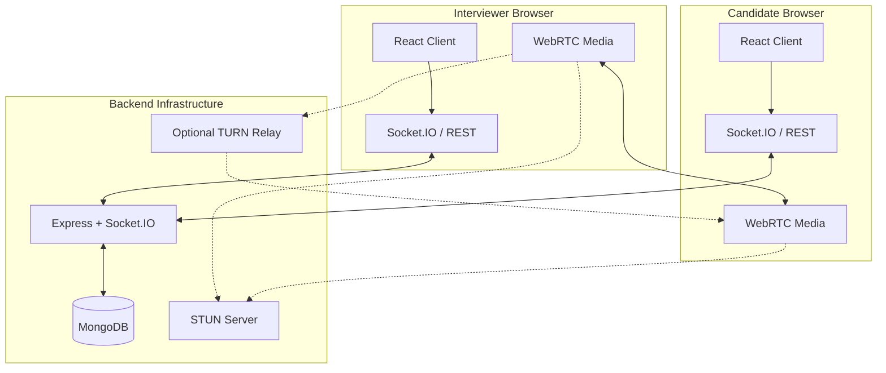
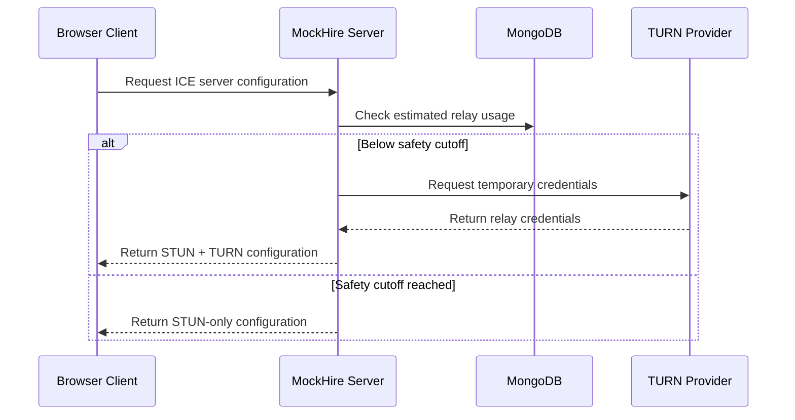

 <div align="center">

# 🎥 MockHire

### Real-Time Video Interview Platform

A real-time platform for conducting technical interviews. Schedule interviews, connect with candidates over peer-to-peer WebRTC video, collaborate through a shared code pad, communicate using real-time chat, and record structured interview feedback — with security treated as a first-class requirement.


</div>

Built with the MERN stack. MockHire uses native WebRTC for peer-to-peer video communication and Socket.IO for real-time signaling, enabling technical interviews without relying on paid video SDKs.

## ✨ Core Features

- **Interviewer Dashboard** — schedule interviews, manage interview sessions, communicate with candidates, and submit structured feedback with ratings, comments, and pass/fail decisions.
- **Candidate Dashboard** — view upcoming and past interviews, join scheduled sessions, use interview room tools, and view result status without accessing private interviewer comments.
- **Real-Time Video Calling** — conduct one-to-one interviews using WebRTC with microphone, camera, and screen-sharing controls.
- **Collaborative Code Pad** — share code and collaborate with the interviewer or candidate during technical discussions.
- **Real-Time Chat** — communicate inside the interview room using Socket.IO.
- **Secure Interview Rooms** — use cryptographically generated room codes, server-side authorization, and an eight-hour room expiry lifecycle.
- **Structured Feedback** — record interview ratings, comments, and evaluation decisions.
- **TURN Connectivity Safeguards** — support TURN relay fallback with usage accounting and a configurable safety cutoff.

## 📸 Interface

Screenshots are stored in `docs/screenshots/`.

| Landing Page | Sign In |
|---|---|
|  |  |

| Interviewer Dashboard | Interview Room |
|---|---|
|  |  |

## 🏗 Architecture & WebRTC Connectivity

MockHire separates application requests and signaling from the peer-to-peer media connection.



### Key Architectural Decisions

- **Peer-to-Peer Media:** WebRTC carries audio and video directly between peers when connectivity permits. The application server handles signaling rather than recording calls.
- **Real-Time Signaling:** Socket.IO coordinates connection setup and real-time room communication.
- **Shared Authentication:** REST requests and WebSocket connections use the application's authentication mechanism.
- **Database-Backed Authorization:** Access to protected interview resources is checked on the server.
- **Connectivity Fallback:** STUN assists connection discovery, while optional TURN relay connectivity helps when direct connections fail.
- **Separated Client and Server:** The React frontend and Express backend are maintained in separate directories.

## 🛡️ TURN Safety Model

MockHire includes a safety mechanism for optional Cloudflare TURN relay usage to reduce the risk of uncontrolled provider usage.



The implementation includes the following safeguards:

- **Temporary Credentials:** Provider credentials are generated for client use without exposing permanent provider secrets.
- **Usage Accounting:** Relay usage is estimated and tracked by the backend.
- **Safety Cutoff:** TURN credentials are withheld when the configured monthly usage threshold is reached.
- **Graceful Fallback:** Existing relay sessions can be drained while room communication infrastructure remains available.

The TURN integration requires the appropriate provider credentials and configuration.

## 🔐 Security & Engineering Highlights

Security is considered throughout authentication, interview management, signaling, and room access.

| Threat | Protection |
|---|---|
| Password theft | bcrypt password hashing |
| Token theft through JavaScript | HTTP-only authentication cookies |
| Cross-site request risks | SameSite cookie policy and origin restrictions |
| Brute-force requests | API rate limiting |
| NoSQL injection | Input sanitization and Mongoose query protections |
| Unauthorized room access | Random room codes and server-side authorization |
| Insecure object access | User-scoped interview resource checks |
| XSS through chat or code | Text rendering and input length limits |
| HTTP header attacks | Helmet and production Content Security Policy |
| TURN resource abuse | Temporary credentials, usage accounting, and safety cutoff |

## 🧪 Testing

MockHire maintains isolated tests and a separate integration test suite.

### Default Test Suite

```bash
npm test
```

The documented default suite contains **104 native `node:test` specifications**, covering server and client tests.

### Integration Test Suite

```bash
npm run test:integration
```

The documented integration suite contains **52 integration checks** using HTTP requests and Socket.IO client interactions.

### Test Prerequisites

- Configure `MONGO_URI` in `server/.env` for database-dependent tests.
- Start the backend before running integration tests that require a live server.
- Ensure the required test ports are available.

Test counts reflect the repository's documented test suites and should be updated if the tests change.

## 📁 Project Structure

```text
MockHire-Video-Interview-Platform/
├── client/
│   ├── public/
│   │   └── favicon.svg
│   ├── src/
│   │   ├── components/
│   │   │   ├── room/
│   │   │   │   ├── ControlBar.jsx
│   │   │   │   ├── SidePanel.jsx
│   │   │   │   └── VideoTile.jsx
│   │   │   ├── AuthLayout.jsx
│   │   │   ├── FeedbackModal.jsx
│   │   │   ├── Modal.jsx
│   │   │   ├── ScheduleModal.jsx
│   │   │   └── ui.jsx
│   │   ├── context/
│   │   │   └── AuthContext.jsx
│   │   ├── lib/
│   │   │   ├── api.js
│   │   │   ├── motion.js
│   │   │   ├── rtc.js
│   │   │   ├── socket.js
│   │   │   ├── theme.js
│   │   │   └── time.js
│   │   ├── pages/
│   │   │   ├── Dashboard.jsx
│   │   │   ├── InterviewRoom.jsx
│   │   │   ├── Landing.jsx
│   │   │   ├── Login.jsx
│   │   │   └── Register.jsx
│   │   ├── index.css
│   │   └── main.jsx
│   ├── tests/
│   │   └── stage3-injection.test.js
│   ├── index.html
│   ├── package.json
│   ├── package-lock.json
│   └── vite.config.js
├── server/
│   ├── src/
│   │   ├── config/
│   │   ├── middleware/
│   │   ├── models/
│   │   ├── routes/
│   │   ├── services/
│   │   ├── socket/
│   │   ├── utils/
│   │   ├── app.js
│   │   └── index.js
│   ├── tests/
│   ├── package.json
│   └── package-lock.json
├── docs/
│   ├── decisions/
│   ├── screenshots/
│   ├── ARCHITECTURE.md
│   ├── FUTURE-SCOPE.md
│   ├── PRD.md
│   └── SECURITY-CHECKLIST.md
├── package.json
├── .gitignore
└── README.md
```

## 🚀 Environment Setup & Local Development

### Prerequisites

- **Node.js:** Version 20 or later
- **npm:** Node package manager
- **MongoDB:** Local MongoDB instance or MongoDB Atlas account

### 1. Clone the Repository

```bash
git clone https://github.com/altafshaikh7/mockhire-video-interview-platform.git
cd mockhire-video-interview-platform
```

### 2. Configure the Backend

```bash
cd server
npm install
```

Create a `.env` file inside the `server` directory:

```env
PORT=5000
MONGO_URI=your_mongodb_connection_string
JWT_SECRET=your_long_random_secret
CLIENT_ORIGIN=http://localhost:5173
NODE_ENV=development
TURN_KEY_ID=
TURN_KEY_API_TOKEN=
```

Replace the example values with your own configuration. Generate a secure JWT secret using:

```bash
node -e "console.log(require('crypto').randomBytes(64).toString('hex'))"
```

Start the backend:

```bash
npm run dev
```

The backend API and signaling server should be available at `http://localhost:5000`.

### 3. Configure the Frontend

Open a second terminal from the project root:

```bash
cd client
npm install
npm run dev
```

The frontend should be available at `http://localhost:5173`.

### Environment Variables

| Variable | Description |
|---|---|
| `PORT` | Backend server port; defaults to `5000` |
| `MONGO_URI` | MongoDB connection string |
| `JWT_SECRET` | Secure secret used for JWT signing |
| `CLIENT_ORIGIN` | Frontend origin allowed by the backend |
| `NODE_ENV` | Application environment |
| `TURN_KEY_ID` | Optional TURN provider API key ID |
| `TURN_KEY_API_TOKEN` | Optional TURN provider API token |

**Important:** Never commit `.env` files, database credentials, JWT secrets, or provider API tokens to GitHub.

## 🚢 Deployment

The application supports a production setup in which the frontend is built and served by the backend, provided the production server configuration is enabled.

Build the frontend:

```bash
cd client
npm install
npm run build
```

Start the backend in production mode:

```bash
cd ../server
npm install
npm start
```

Use the start script configured in `server/package.json`. Configure production environment variables, CORS/origin settings, database access, and any required TURN provider credentials before deployment.

## 📖 Documentation

Explore the documentation included in the repository:

1. [`docs/ARCHITECTURE.md`](docs/ARCHITECTURE.md) — system architecture and backend design.
2. [`docs/PRD.md`](docs/PRD.md) — product requirements and project scope.
3. [`docs/SECURITY-CHECKLIST.md`](docs/SECURITY-CHECKLIST.md) — security requirements and implementation checks.
4. [`docs/decisions/`](docs/decisions/) — architecture decisions and development milestones.
5. [`docs/FUTURE-SCOPE.md`](docs/FUTURE-SCOPE.md) — planned improvements and future development.

## 🗺️ Future Improvements

Potential improvements for future versions include:

- Enhanced code editing and collaborative programming.
- Secure code execution with output display.
- Additional programming language support.
- Improved interview analytics and reporting.
- More robust connectivity monitoring.
- Production deployment and scalability improvements.

## 👨‍💻 Author

**Altaf Shaikh**

- GitHub: [@altafshaikh7](https://github.com/altafshaikh7)
- Portfolio: [shaikhaltaf.netlify.app](https://altafshaikh-portfolio.vercel.app/)

---

If you find MockHire useful, consider giving the repository a star!

